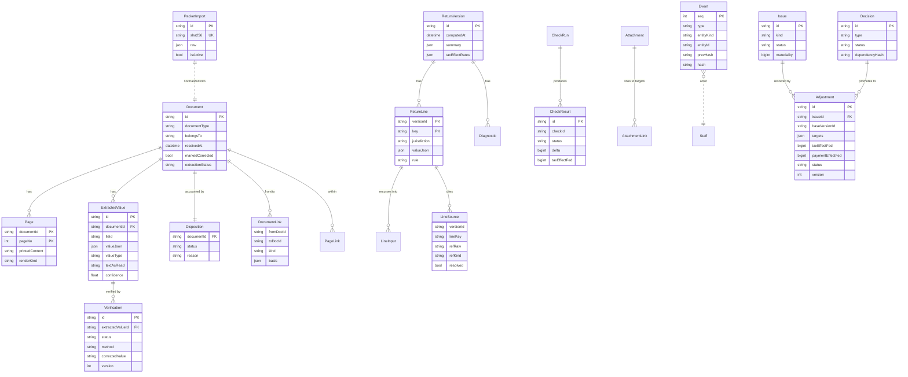

# Data model

Three layers. **Layer A is never mutated.** Layer B is read-only after import.
Layer C is the workpaper we build, and every write to it emits one append-only
`Event` with an actor — so Change / Judgment / People / Filing slot in later
without reshaping anything.

Pure logic (verification, trace, disposition, links, and the Block 2 checks)
runs on an in-memory `PacketModel` built from the validated packet. The database
persists the raw import, the normalized packet, and the workpaper/event layer.
Tests run against the model with no database.

## ER diagram

## Block 2 — Change + Judgment (layer C additions)

- **`Issue`** groups many `CheckResult`s into one problem (fingerprint = class +
  anchor document/line). Tax effect lives on the Issue/Adjustment, deduped per
  line — never summed across raw findings.
- **`Adjustment`** layers over the engine base; the original packet value is
  copied into `targets[].baseValue` and never mutated. Four effect columns keep
  tax and payments separate. `version` gives optimistic concurrency (stale write
  → 409). Workflow: draft → proposed → reviewed → approved; or rejected /
  reverted / stale / absorbed. Change to an approved row = a new adjustment that
  `supersedes` it, or a revert by the approver.
- **`FactCorrection`** corrects an extracted value (e.g. the D62 EIN) without
  touching the import; the `Verification` row points to it.
- **`Batch`** records a bulk action; undo writes a compensating `Batch` and
  events — history is never deleted.
- **`Snapshot`** (immutable), **`Scenario`** (what-if sandbox; never affects the
  workpaper), **`UserCursor`** (seq-based "since I last looked").
- Judgment models (**`Decision`**, **`DueDiligence`**, **`ExpectedDocument`**,
  **`AreaReview`**, **`OutsideFiling`**) are in the schema for Feature 4.

## Why these shapes

- **Money is integer cents** (`bigint`) in code; `valueJson` keeps the packet's
  raw value and we convert once via `src/lib/money.ts`.
- **`Verification.status` is a fact about the page**, never confidence. Low
  confidence routes to `needs_human` separately.
- **`Disposition` guarantees completeness**: every document resolves to a
  non-`unaccounted` status, time-aware against the as-of clock.
- **`Event` is hash-chained** (`prevHash` → `hash`, monotonic `seq`) so tampering
  is detectable. Mutable Layer-C rows carry a `version` int for optimistic
  concurrency (stale write → 409 in later blocks).
- **Stable finding IDs** (`CheckResult.id`) = `sha256(checkId + sorted refs)` so
  re-running checks is idempotent and notes/approvals attach to a stable id.
